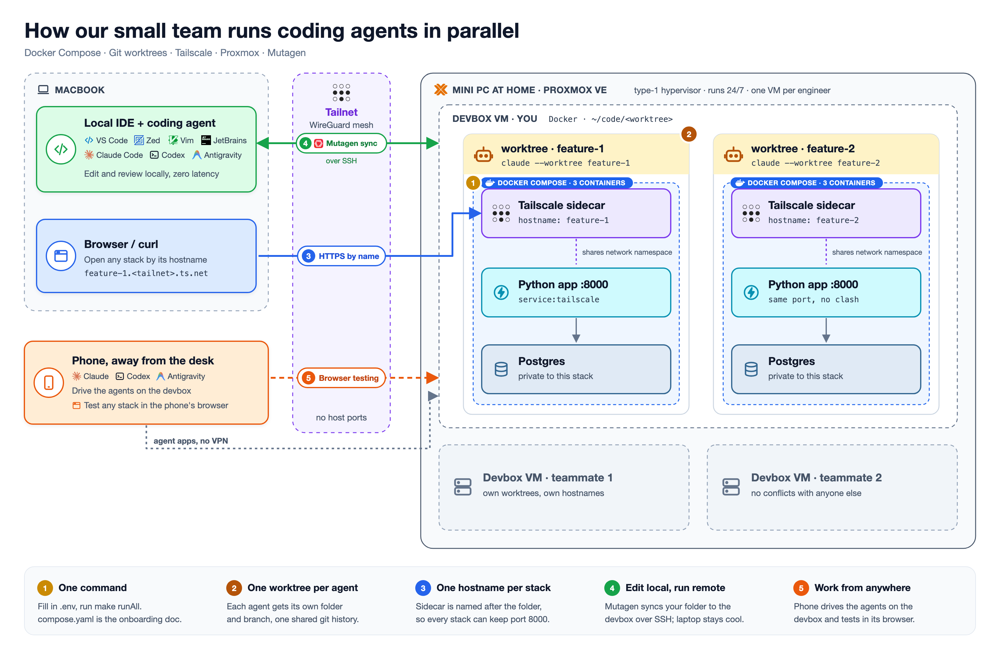

# parallel-agent-stacks

Run several coding agents in parallel, each with its own isolated stack: one Docker Compose stack per git worktree,
each on its own Tailscale hostname, optionally running on a remote devbox synced with Mutagen.

The demo app is a small FastAPI + Postgres service. The ideas behind it are explained in a companion blog post
(link coming soon).



## Prerequisites

- Docker
- `make` (included on macOS; `sudo apt install make` on Ubuntu)
- A Tailscale account and an auth key. It must be **reusable**, since every worktree's sidecar signs in with it.
  Leave **Ephemeral** off: ephemeral nodes use a monthly minutes quota on the free plan.
- For a remote devbox: SSH access to it and [Mutagen](https://mutagen.io)

## One command to run everything

```bash
cp .env.example .env    # fill in TS_AUTHKEY
make runAll             # same as: docker compose up -d --build
```

The stack (`compose.yaml`) is:

| service     | role                                                             |
|-------------|------------------------------------------------------------------|
| `tailscale` | sidecar, joins your tailnet as `${COMPOSE_PROJECT_NAME}`         |
| `app`       | FastAPI on :8000, `network_mode: service:tailscale`, hot reload  |
| `db`        | Postgres, only reachable inside the stack                        |

To add a service, add it to `compose.yaml` with its dev values written in. Only keys for online services go in
`.env.example`. The Compose file is the onboarding doc.

## Parallel agents: one worktree, one stack, one hostname each

```bash
claude --worktree feature-1     # -> .claude/worktrees/feature-1
# inside the agent session:
make runAll                     # -> http://feature-1:8000
```

- `.worktreeinclude` makes Claude Code copy `.env` into each new worktree.
- Compose names containers, networks and volumes after the folder, so every worktree gets its own database.
- No host ports are published, so any number of stacks can all use :8000.
- Open `http://<folder>:8000` (MagicDNS) or `https://<folder>.<your-tailnet>.ts.net`
  (Tailscale Serve; enable HTTPS in your tailnet's admin settings).

Try it:

```bash
curl -XPOST http://feature-1:8000/notes -H 'content-type: application/json' -d '{"body":"hi"}'
```

## Run on a devbox, edit locally

One-time setup on the devbox (Ubuntu). The script installs `make`, Docker and Tailscale, and asks for your sudo
password:

```bash
scp scripts/devbox-setup.sh devbox:
ssh -t devbox 'bash devbox-setup.sh'
```

Then, from any folder or worktree on your laptop:

```bash
make sync       # once per folder: Mutagen two-way sync -> devbox:~/code/<folder>
make remoteUp   # docker compose up on the devbox
make remoteLogs s=app
make syncStop
```

Set `DEVBOX` in `.env` to your devbox's SSH host. The remote folder has the same name as the local one, so the
Compose project and Tailscale hostname stay the same whichever machine runs the stack.

## Notes

- When you delete a worktree, remove its offline node in the Tailscale admin console.
- If you move a stack to another machine, remove the old node first, or the new one comes up as `<name>-1`.
- The first HTTPS request to a new stack can take a moment while Tailscale gets its certificate.

## Commands

`make` with no arguments lists every command.

## License

[MIT](LICENSE)
